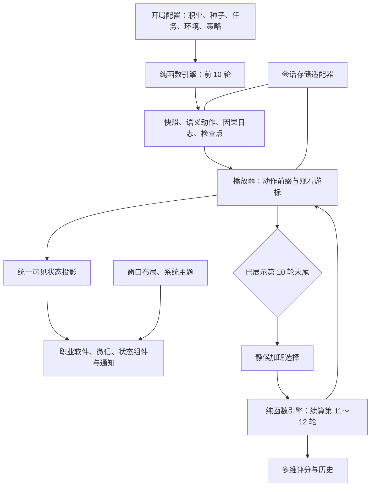

# 阶段 1：需求分析与架构设计

- 需求：`REQ-20261109143131`，入口见 [README](README.md)。
- 依据：[用户原始开发要求 V1.2](20261109143131-原始开发要求V1.2.md)，尤其是第十二节“先架构，确认后再编码”。
- 创建时间：2026-11-09 14:31:31，`Asia/Shanghai`。
- 关联聊天：2026-11-09 当前开发聊天；聊天 ID 未取得；本阶段从会话-1 开始。
- 仓库：`/Users/didi/Documents/ChatGPT/打工人桌面模拟器`；分支 `main`；初始为空仓库，尚无任何提交。
- 本次提交：尚未提交。本文件中全部源码路径、函数签名、公式与参数均为设计，未实现、未运行。
- 阶段状态：方案已记录，等待用户确认；功能开发尚未开始。

## 1. 目标、约束与设计结论

玩家配置一名员工，再观察电脑自动办公；系统通过同一事件流串起消息、规则、工作动作、软件画面和绩效解释。桌面是主视觉，策略在开局后锁定，局内唯一影响工作结果的输入是第 10 轮后的加班选择。

采用 **原生 JavaScript ES Modules + Vite + DOM/CSS** 的单页应用。Vite 仅负责开发服务与静态打包；Node 内置测试运行器验证引擎，不进入浏览器运行时。项目不依赖框架、游戏引擎、服务器、LLM 或真实办公软件。

确定性模拟、可取消的回放、桌面窗口和存储分别维护状态。引擎生成前 10 轮结果与检查点，播放器消费到该边界后显示选择。选择后生成后两轮；**不加班仍推进正常节奏的第 11～12 轮**，加班提高后两轮可用产能并增加消耗。任何播放控制和系统外观切换都不能重算逻辑。

四职业共享轮次调度、消息规则和动作契约，但通过各自的任务状态机、交付物操作和风险传播器实现差异。NPC 仅是本局脚本化事件来源，不建立其他职业的独立生产状态。

## 2. 拟定项目文件树

以下是确认后逐步建立的结构；本轮只创建文档，不预建源码或脚手架。

```text
打工人桌面模拟器/
├── AGENTS.md
├── CLAUDE.md
├── TODO.md
├── .agentdocs/
│   ├── index.md
│   └── workflow/REQ-20261109143131-单职业桌面模拟器/
│       ├── README.md
│       ├── 20261109143131-原始开发要求V1.2.md
│       └── 20261109143131-需求分析.md
├── package.json                     # 确认后配置 dev、build、preview、test
├── package-lock.json                # 锁定实际使用的依赖版本
├── index.html
├── main.js                          # 应用装配与页面路由
├── data/
│   ├── professions.js               # 职业、软件、专属参数与评分权重
│   ├── parameters.js                # 四组参数、提示、预设及互斥约束
│   ├── tasks.js                     # 每职业具体任务书、子任务与依赖
│   ├── environments.js              # 已知环境、种子化场景生成
│   └── events.js                    # 每职业至少 12 个有意义的候选事件
├── sim/
│   ├── schema.js                    # 数据验证、枚举与版本常量
│   ├── prng.js                      # mulberry32、独立随机流及状态导出
│   ├── engine.js                    # 轮次、检查点、加班续算
│   ├── strategies.js                # 消息优先级、沟通和预算分配
│   ├── actions.js                   # 语义动作、交付物补丁与因果日志
│   ├── scoring.js                   # 绩效、短板及关键事件
│   └── professions/
│       ├── programmer.js            # 编码/调试/测试/提交与技术债
│       ├── finance.js               # 对账/公式/审批与错误传播
│       ├── product.js               # 需求/评审/确认与范围失控
│       └── designer.js              # 提案/反馈/改稿与创意疲劳
├── playback/
│   ├── controller.js                # 播放、暂停、跳转、边界通知
│   ├── projection.js                # 纯函数：动作前缀→可见工作状态
│   ├── pacing.js                    # 仅将动作映射到演出时长
│   └── cursor.js                    # 模拟指针与稳定目标定位
├── desktop/
│   ├── shell.js                     # 桌面和系统外观切换
│   ├── window-manager.js            # 拖动、缩放、最大/最小化和恢复
│   ├── macos.js                     # 顶部菜单栏、Dock、左侧窗口按钮
│   ├── windows.js                   # 桌面图标、任务栏、右侧窗口按钮
│   └── notifications.js             # 按已播放动作展示通知
├── apps/
│   ├── vscode.js                    # 文件树、代码、终端、测试、提交
│   ├── excel.js                     # 关联工作表、公式栏、错误来源
│   ├── word.js                      # 文档、需求、批注和修订
│   ├── photoshop.js                 # 画布、图层、属性、提案版本
│   └── wechat.js                    # 会话、群聊、未读及自动回复
├── ui/
│   ├── setup.js                     # 职业、任务、环境、策略与播放节奏
│   ├── overtime.js                  # 唯一局内工作决策
│   ├── report.js                    # 分项绩效、短板、事件因果
│   └── history.js                   # 筛选与至少两局并排比较
├── meta/
│   ├── storage.js                   # localStorage 适配及错误处理
│   ├── session.js                   # 当前会话保存、校验和恢复
│   ├── presets.js                   # 用户配置和默认预设
│   └── history.js                   # 历史写入去重、版本及比较
├── styles/
│   ├── tokens.css                   # 颜色、间距、层级、动效 CSS 变量
│   ├── desktop.css
│   ├── macos.css
│   ├── windows.css
│   ├── apps.css
│   └── screens.css
├── assets/                         # 自制图标、壁纸及原创设计素材
└── tests/
    ├── determinism.test.js
    ├── engine.test.js
    ├── strategies.test.js
    ├── professions.test.js
    ├── scoring.test.js
    ├── playback.test.js
    ├── persistence.test.js
    └── balance.test.js
```

不创建多 Agent 目录、NPC 调度器、后端、API 网关或 Electron 工程。`tests/` 使用既有 Node 能力，浏览器验证工具在桌面阶段按实际环境接入。

## 3. 分层边界与数据流



| 层 | 拥有的数据与职责 | 边界 |
| --- | --- | --- |
| 数据定义 | 任务模板、参数范围、候选事件、版本 | 不读写运行中的玩家状态 |
| 模拟引擎 | 输入、工作状态、消息、交付物、动作与评分输入 | 不读 DOM、时间、网络或存储；不接收窗口坐标和播放倍速 |
| 播放投影 | 已完成动作前缀对应的可见工作状态 | 只应用引擎输出，不能生成消息、工作结果或随机事件 |
| 演出控制 | 观看游标、暂停、倍速、可取消动画 | 不能重新调用模拟推进来“加速” |
| 桌面/软件 UI | 窗口布局、主题、选中会话、日志查看位置 | 查看或整理窗口不能修改逻辑状态 |
| 持久化/历史 | 保存和校验版本化数据、比较已完成局 | 不把上一局关系或得分带入新局 |

引擎的最终状态可能已到第 10 轮，播放器仍在第 2 轮。界面只能显示已播放动作前缀的状态、消息和日志，不提前泄露剩余轮次的内容。

## 4. 三类状态机

### 4.1 模拟生命周期

```text
validated_input
  → simulate_rounds_1_to_10
  → awaiting_overtime_choice
       ├─ 无选择：检查点保持不动，不计时、不惩罚
       └─ 接收 overtime=true/false
            → simulate_rounds_11_to_12
            → completed
            → score_ready
```

`awaiting_overtime_choice` 是引擎检查点状态，未收到选择绝不计算第 11 轮。它不等于播放器已经展示到了第 10 轮；界面选择入口还受播放边界限制。

选择从 `null` 变成布尔值后固定，重复同一输入续算返回相同结果；控制器拒绝重复插入续算片段，也不允许在同局更改选择。重新挑战创建独立新局。

### 4.2 观看生命周期

```text
setup → playing ↔ paused
           ↓ 页面隐藏或刷新恢复
       suspended → paused → playing
           ↓ 前 10 轮动作全部展示
       awaiting_choice → playing → finished → report
```

`awaiting_choice` 无倒计时。查看日志、窗口拖动、最小化或外观切换是正交的界面状态，不切换工作状态机。

### 4.3 职业工作状态机

| 职业 | 主工作循环 | 条件分支与专属状态 | 画面与后果 |
| --- | --- | --- | --- |
| 程序员 | 待依赖→编码→调试→测试→评审→提交 | 测试失败回到调试；变更进入编码或重构；技术债提高后续故障与修复成本 | 对应代码块被修改，终端出现关联测试、失败原因与提交记录；债务被保留而非提交后清零 |
| 财务 | 收集凭证→录入→核对→公式计算→报表→审批→交付 | 原始错误沿表依赖传播；异常上报与审批链决定阻塞；绕过审批单独标为未审批交付 | 原始表与关联表出现同源异常；修正后重新计算受影响单元格；合规风险随缺失审批累积 |
| 产品经理 | 收集→撰写→评审→确认→基线；变更→影响评估→修订→再确认 | 冲突意见等待澄清；接受变更新增工作量并使相关确认失效；范围失控增加后续评审成本 | PRD 留下修订和批注，需求条目有确认人、版本与冲突来源 |
| 设计师 | 理解意图→概念设计→提案→反馈→改稿→验收交付 | 客户偏好由环境生成；多方案增加前期消耗并降低误判概率；改稿上限后仍未获认可则保留未验收状态 | 图层、配色、版式和版本真实变化；创意疲劳影响方案质量与返工 |

每个子任务独立维护步骤、进度和依赖。并行度表示一轮分配给几个任务，所有可见动作仍按统一队列顺序演出。

程序员工作循环中的测试是模拟交付门禁，自测频率表示额外主动检查；“从不自测”不凭空取消其他角色或流程产生的失败反馈。财务未审批、产品未确认、设计未验收不能仅因工作量耗尽就标为完全交付。

## 5. 核心数据契约（schema）

采用 JSON 可序列化的普通对象，用 JSDoc（JavaScript 类型注释）说明类型，运行入口执行字段校验。本节是契约设计，不创建实现文件。枚举使用稳定英文 ID，展示文案与注释使用中文。

### 5.1 版本、标识与数值约定

- 逻辑输出携带 `schemaVersion`、`engineVersion`、`contentVersion`；历史另带 `scoringVersion`。
- `seed` 为 0～4294967295 的无符号整数；UI 可以在开局前生成并公开新种子，引擎只接受已确定种子。
- 逻辑 ID 使用轮次与递增序号，例如 `r03:e02`、`r03:a007`，不依赖 UUID 或真实时间；跨局唯一的 `runId` 由应用层生成，不进入逻辑输出。
- 所有顺序显式记录并按稳定 ID 处理相同优先级，不能依赖对象遍历的偶然顺序。
- 状态计算使用整数或基点（10000 表示 100%），统一在规则边界取整；展示层才转换为百分比。
- `inputFingerprint` 是规范化输入的检索标识，不能替代完整输入比较；涉及可复现判断时还核对完整输入与版本。

### 5.2 职业 `ProfessionDefinition`

| 字段 | 内容 |
| --- | --- |
| `id` | `programmer / finance / product / designer` |
| `name / description / primaryAppId` | 中文职业信息及 `vscode / excel / word / photoshop` |
| `taskTemplateIds / eventPoolId` | 可选任务模板和专属候选事件集 |
| `specialParameterIds` | 本职业专属参数列表 |
| `stateMachineId / riskModelId` | 对应纯函数适配器的注册 ID；存档不序列化函数 |
| `baseCapacity / scoreWeights` | 无现实时间含义的基础动作预算、六维权重 |

### 5.3 任务书、子任务与依赖

| 对象 | 字段与约束 |
| --- | --- |
| `TaskBrief` | `id, templateId, version, title, background, difficulty, subtasks[2..5], dependencies, riskNotes, artifactIds` |
| `SubtaskDefinition` | `id, title, difficulty, requiredWork, completionWeight, dependsOn[], deadlineRound, isCritical, artifactIds[]` |
| `TaskRuntime` | `taskId, stage, stageWork, remainingWork, addedWork, reworkWork, progressBp, quality, errors[], blockers[], acceptedVersion, completed` |
| `Dependency` | `fromTaskId, toTaskId, requiredStage, affectedArtifactIds`；开局校验无循环 |

四份初始任务书建议各含 4 项子任务：

| 职业 | 具体任务 | 子任务与依赖 | 已公开风险 |
| --- | --- | --- | --- |
| 程序员 | 开发订单退款模块 | 数据结构→退款接口→异常处理→联调及提交 | 幂等要求、遗留代码、客户变更 |
| 财务 | 核对季度经营报表 | 凭证明细→跨表对账→公式汇总→审批报表 | 发票缺失、税率口径、审批完整性 |
| 产品经理 | 编写退款自助化 PRD | 访谈→流程与边界→评审协调→基线确认 | 业务意见冲突、临时加需求 |
| 设计师 | 制作年末活动主视觉 | 意图梳理→主视觉→延展尺寸→提案交付 | 风格偏好、渠道规范、反复改稿 |

### 5.4 环境 `Environment`

字段：`id, seed, templateVersion, bossStyle, clientChangeFrequency, urgency, collaborationClimate, professionContext, disclosedTraits[]`。

- `bossStyle`：重结果、重过程或高响应期待；影响消息与反馈规则。
- `clientChangeFrequency`：稳定、适中或频繁；影响公开的变更倾向。
- `urgency`：常规或紧急；确定子任务截止条件和未完成后果。
- `professionContext`：遗留系统债务、报表复杂度、干系人冲突或客户偏好等职业输入。
- 场景生成只依赖种子、职业与内容版本，与策略、主题和播放速度无关。开局展示管理风格、变更倾向、任务难度与主要风险；随机事件不是全部预告。
- 存档保存环境和任务书的完整实例，避免后续内容更新导致历史场景漂移。

### 5.5 策略 `StrategyConfig`

| 组 | 字段、范围与权衡 |
| --- | --- |
| A 工作强度 | `intensity: 0..100`；`focusMode: deep / parallel`；`parallelism: 1..3`。强度提高预算并增加疲劳，多线提高吞吐但有切换损耗 |
| B 时间与沟通 | `mainTaskShare: 30..90`；`wechatMode: instant / delayed / batch`；`priorityRules: RuleId[0..4]`。主任务份额与沟通积压相互制约 |
| C 质量与风险 | `changeAcceptance: 0..100`；`qualityPreference: fast / balanced / meticulous`；`selfCheck: never / milestones / everyStep`；`redlineTolerance: zero / flexible / risky` |
| D 专属 | `special`：当前职业的参数对象，见下表 |

| 职业 | 专属字段与拟定选项 |
| --- | --- |
| 程序员 | `debtTolerance: 0..100`；`refactorOnChange: boolean`；`reviewStrictness: lenient / standard / strict` |
| 财务 | `formulaCheck: never / milestones / everyStep`；`anomalyReporting: 0..100`；`bypassApproval: boolean` |
| 产品经理 | `documentDetail: 0..100`；`stakeholderPriority: boss / client / team`；`meetingParticipation: 0..100` |
| 设计师 | `revisionLimit: 1..5`；`multiProposal: boolean`；`intentStrategy: clarify / reference / intuition` |

专属字段选项是设计提案，提示同时说明收益和成本。通用复核和职业核查有重叠时合并检查动作，实际检查深度取相应规则，不重复扣费。“零容忍”与“绕过审批”等实质矛盾配置在配置页明确提示并阻止开局，不能静默忽略其中一个参数。

`ParameterDefinition` 包含 `id, group, label, type, min, max, step, options, defaultValue, benefit, cost, visibleWhen, conflictsWith`。四个预设保存完整参数值，使用预设只填表，没有名称加成；用户可修改、另存、恢复默认。开局校验并冻结配置，局内只读。

### 5.6 规则 `PriorityRule`

字段：`id, label, conditionId, responseIntent, conflictsWith[], explanationTemplate`。列表索引就是执行优先级，先匹配的有效规则决定本条消息的响应意图。

| 规则 ID | 条件与决策 |
| --- | --- |
| `boss_first` | 老板来信优先安排即时处理 |
| `client_first` | 客户来信优先安排即时处理 |
| `finish_first` | 主任务加权剩余进度严格低于 20% 时，非紧急消息延后至交付节点；紧急消息不匹配 |
| `unread_batch` | 未读严格超过 5 条时安排一批处理 |
| `help_colleague` | 同事求助优先响应 |
| `defer_colleague` | 同事求助推迟到后续沟通窗口 |

最后两条互斥；最多装入 4 条，拖拽与键盘上下移动均可排序。若“老板优先”排在“未读批处理”之前，老板消息即时处理，其他符合条件的消息仍可批量。日志保留首个命中规则；未命中记为 `default:<wechatMode>`。

即时处理仍消耗预算并产生中断；预算不足时标为待处理，不能免费回复。延迟默认在下一轮沟通阶段尝试，批处理默认每轮沟通窗口执行；消息到期且未回复会触发明确后果。

### 5.7 候选事件、运行事件与消息

| 对象 | 字段 |
| --- | --- |
| `EventDefinition` | `id, professionId, category, source, intent, eligibleRounds, environmentConditions, stateConditions, weight, cooldownRounds, maxOccurrences, urgency, deadlinePolicy, effectId, templateId` |
| `SimEvent` | `eventId, sequence, round, kind, source, sender, recipient, intent, urgency, deadlineRound, relatedTaskId, artifactId, parentEventId, payload` |
| `Message` | `id, eventId, conversationId, sender, recipient, relatedTaskId, artifactId, intent, urgency, arrivedRound, deadlineRound, text, status, replyEventId` |

`source` 至少包含 `kind: boss / client / colleague / system / self` 及 `actorId`；消息 `status` 区分未读、已读待处理、延期、已回复、已过期。联系人和关系只存在于本局。

每职业至少 12 个有意义的候选事件，覆盖变更、求助、错误反馈、截止提醒、流程冲突、认可与恢复机会；不要求每局全部触发。外生事件由独立种子流及公开环境决定，策略不改写消息源；内生事件由错误、积压、疲劳等实际状态触发。

`sender / recipient / relatedTaskId / artifactId / intent` 只服务当前因果关联，不因此建立未来协作系统。

### 5.8 交付物 `Artifact`

共同字段为 `id, kind, taskId, version, status, content`，内容按职业区分：

| 类别 | 内容与因果追踪 |
| --- | --- |
| 代码 | `files[{id,path,blocks}], tests[], diagnostics[], commits[]`；修改与失败通过文件及稳定代码块 ID 关联 |
| 表格 | `sheets[], cells, formulas, cellDependencies, anomalies[]`；公式使用受控规则计算，不执行任意代码 |
| 文档 | `sections[], requirements[], revisions[], comments[], confirmations[]`；变更保留前后版本和来源 |
| 设计 | `canvas, layers[], properties, proposals[], revisions[], approval`；图层变动与反馈关联 |

交付物是引擎可序列化状态，不以 DOM 或输入框内容作为事实来源。模拟代码、公式、文档和素材均不执行用户系统命令或任意 JavaScript。

### 5.9 语义动作 `SemanticAction`

字段：`actionId, sequence, round, eventId, parentEventId, relatedTaskId, artifactId, actorId, appId, kind, payload, artifactPatches[], stateDelta[], presentation, importance`。

- `kind` 示例：`code.edit, code.test, code.submit, sheet.input, sheet.recalculate, sheet.audit, doc.revise, doc.comment, design.changeLayer, design.propose, chat.receive, chat.reply, chat.defer, round.end, decision.boundary`。
- `artifactPatches` 使用明确的领域操作和稳定目标 ID，例如替换代码块、写单元格、修订章节、更新图层；携带前后版本用于校验。
- `stateDelta` 与该动作完成后的工作状态变化一致，避免进度已增加而画面仍是旧内容；它与 `artifactPatches` 的写入路径不得重叠。同一次变更只应用一次，日志只引用变更证据，不再次应用增量。
- `presentation` 只包含目标语义、文本、选择区域、是否切换应用等演出提示；不存像素坐标、主题或真实时长。
- `importance: normal / key` 由规则和事件重要性决定，供跳转使用，不由播放器随机标记。
- 指针移动、点击、打字等由动作内容展开；输入字符串已经确定，打字动画不能临时生成文本。

### 5.10 工作状态与快照

`SimState`：`round, phase, tasks, artifacts, messages, relationships, energy, accumulatedEnergyCost, overwork, interruptionCost, unreadPressure, errorRateBp, errors, rework, professionState, npcExpectations, metrics`。

`relationships` 包含老板、客户、同事维度；`npcExpectations` 只记录本局秒回造成的期待变化。职业状态分别记录技术债、合规风险、范围失控、创意疲劳及必要的专属明细。

`RoundSnapshot`：`schemaVersion, round, phase, state, actionEndSequence, logEndSequence`。单独保存 `initialState`，完成局恰好有 12 份轮末快照；前段恰好 10 份，续算片段恰好 2 份。

各快照独立不可变，不能因后续数组或对象被修改而改变历史。测试校验“初态 + 动作前缀”投影与对应轮末快照相同。

### 5.11 因果日志 `CausalLog`

必填字段：`round, eventId, source, action, triggeredRule, stateDelta, consequence, relatedTaskId`；另有 `logId, sequence, parentEventId, actionIds[], artifactId, importance`。

`stateDelta` 是有序数组，每项为 `path, before, after, reason`，数值与状态枚举均可表达。`consequence` 同时保留结构化后果代码和中文说明。后续返工事件用 `parentEventId` 指向原始错误或被接受的变更。

没有匹配用户规则时也必须记录实际默认规则；不将“随机倒霉”当作原因。概率事件记录环境条件、风险因子及已发生的后果，不伪造确定性因果或未运行过的反事实。

### 5.12 输入、检查点与运行输出

| 对象 | 字段与约束 |
| --- | --- |
| `RunInput` | `schemaVersion, engineVersion, contentVersion, seed, professionId, taskBrief, environment, strategy`；不包含主题、速度、窗口或存储时间 |
| `OvertimeCheckpoint` | `input, phase: awaiting_overtime_choice, completedRound: 10, state, rngStates, eventCounters, pendingEvents, pendingMessages, sequenceCounters, actionEndSequence, logEndSequence` |
| `RegularSegment` | `input, initialState, snapshots[10], actions[], logs[], checkpoint` |
| `ContinuationSegment` | `inputFingerprint, overtimeChoice, snapshots[2], actions[], logs[], finalState`；动作和日志序号接续前段 |
| `CompletedRun` | `input, overtimeChoice, initialState, snapshots[12], actions[], logs[], finalState, performance` |

`rngStates` 包含各独立随机流状态。计数器、冷却、截止条件和延期队列同样必须保存，不能只保存体力、进度和一个初始种子。续算校验检查点版本、轮次与序号完整性。

### 5.13 播放状态、会话与历史

| 对象 | 字段与约束 |
| --- | --- |
| `PlaybackState` | `segmentId, nextActionIndex, status, speed, pacingPreset, currentActionOffset`；`nextActionIndex` 表示尚未提交的下一动作 |
| `ViewPreferences` | `osTheme, windowLayouts, openPanels, selectedConversation`；不写回工作状态 |
| `SavedSession` | `storageVersion, runId, regularSegment, continuationSegment?, overtimeChoice, playbackState, viewPreferences, savedAt` |
| `HistoryRecord` | `storageVersion, runId, createdAt, versions, input, overtimeChoice, performance, keyEvents, comparisonSummary` |

`runId / savedAt / createdAt` 是应用元数据，不参与确定性输出比较。历史保留完整职业、种子、任务、环境和策略，另存六维评分、关键事件与辅助指标。当前会话保存完整动作流供刷新恢复，历史以解释性摘要控制体积。

## 6. 轮内调度与非线性策略

每轮采用固定流程：

1. 读取轮初状态与到期条件，生成该轮外生事件；在环境、职业和冷却约束下选择候选事件。
2. 消息进入对应会话和未读队列，创建 `chat.receive` 动作；按顺序规则确定响应意图。
3. 计算该轮可用动作预算，分配主任务、沟通、检查和必要杂务；依据消息策略记录打断及切换损耗。
4. 推进当前可执行子任务的职业状态机，形成可应用的交付物补丁；未满足依赖的任务不凭空推进。
5. 根据质量、疲劳、专属风险与核查策略处理错误、发现、修正和审批；内生事件继续形成关联动作。
6. 消化沟通预算并更新关系、积压、体力、过劳和本局期待，处理本轮截止后果。
7. 追加 `round.end` 动作及独立快照；第 10 轮追加决策边界，第 12 轮完成结算输入。

动作预算是游戏规则单位，不是现实分钟或虚拟工时。主任务份额确定优先预算分配，额外检查与返工占用工作预算，沟通占用沟通预算；临时抢占必须记录从何处扣除，未用预算可以按显式规则回收，不能重复使用。

拟定有效产能结构：`基础预算 × 强度系数 × 体力系数 × 专注系数 × 切换系数 × 过载系数`。强度为 0 时不产生主动工作产能；高强度、多线、秒回同时出现时，打断与疲劳触发过载阈值，可能降低实际产能。

质量风险由工作难度、职业风险、疲劳、检查深度等共同决定。高风险容忍度既可能省去步骤，又会放大故障、缺失审批或误判的损失与波动；不使用“惩罚当前第一名”或预设名称加减分。

加班仅在后两轮改变预算和消耗系数，初拟可用预算上限为正常节奏的 1.35 倍，体力成本高于正常节奏；体力不足时实际收益受抑制，错误与过劳随状态变化。该系数等待平衡测试调整，**评分器不读取加班布尔值加减分**。

用独立随机流区分场景、外生消息和工作风险，避免策略的随机调用次数改变同种子的基础环境。相同输入的所有分支、消息、补丁和日志均严格可重复。参数调整引起的内生事件差异属于策略后果，必须能追溯。

## 7. 引擎与播放器的接口

以下为契约签名，不是已经可运行的代码。

| 接口 | 输入→输出 | 调用边界 |
| --- | --- | --- |
| `createScenario(seed, professionId, contentVersion)` | 种子及职业→任务书、环境 | 纯函数；配置页预览并公开环境 |
| `validateRunInput(input)` | 开局数据→规范输入或中文错误列表 | 冻结配置前调用 |
| `simulateRegular(input)` | 规范输入→`RegularSegment` | 一次生成前 10 轮及检查点 |
| `continueAfterOvertime(checkpoint, choice)` | 第 10 轮完整检查点及布尔值→`ContinuationSegment` | 未提供选择不得续算；不重算前段 |
| `mergeSegments(regular, continuation)` | 两个序号连续且输入匹配的片段→完整运行 | 校验重复、遗漏和错误片段 |
| `scoreRun(completedRun)` | 已完成的 12 轮逻辑→绩效明细 | 不接收播放或窗口状态 |
| `project(initialState, actions, endExclusive)` | 初态及动作前缀→可见工作状态 | 纯函数；窗口、日志与状态共同消费 |
| `player.load(segment, cursor)` | 已确定动作及观看位置→装载 | 不执行工作计算 |
| `player.play / pause / setSpeed` | 观看命令→播放状态 | 不产生模拟事件 |
| `player.skipToNextKey` | 当前游标→下一个关键节点 | 完整应用中间动作，仅省略普通演出 |
| `player.append(continuation)` | 续算片段→可播放动作增长 | 仅一次，检验全局动作序号 |
| `player.getSaveState()` | 当前会话→可序列化游标 | 不序列化 DOM、动画对象或定时器 |

播放器通过 `onActionCommitted / onBoundary / onFinished / onStatusChanged` 通知应用协调器。只有应用协调器能在玩家提交加班选择后调用续算接口；软件窗口没有写入引擎的引用。

每次播放、跳转或加载递增 `playbackEpoch`（播放代次）。异步打字、指针移动等回调提交前核对代次和动作序号，旧回调不能在暂停、跳转或切换会话后重复提交动作。

## 8. “事件→行动→画面”闭环示例

以程序员第 3 轮收到退款幂等规则变更为例：

| 阶段 | 引擎事实 | 可见结果 |
| --- | --- | --- |
| 收到消息 | `r03:e01` 引用退款接口任务及代码交付物 | 微信出现明确提及退款规则的客户消息、未读与通知 |
| 规则匹配 | `client_first` 首先命中，沟通预算允许即时回应 | 模拟指针前往微信，自动输入预先确定的回复；日志解释优先级 |
| 决定接受 | 接受度、变更规模和风险约束满足条件 | 回复内容承诺对应范围，任务新增工作量与返工项 |
| 工作动作 | 专属策略决定重构或局部修改，生成代码块补丁 | VSCode 打开正确文件，修改幂等校验代码；不播放不相关随机代码 |
| 检查与后果 | 自测发现重复退款路径，生成关联修复和测试动作 | 终端先出现失败项，再显示修复后的测试；疲劳、进度和债务同步变化 |
| 复盘 | 日志通过父事件关联接受、修改、发现和返工 | 可追溯本次回复策略为何提高满意度、为何挤占后续任务 |

若预算不足或策略选择延期，微信保留未读/待处理状态，不预先修改代码。若拒绝变更，工作量不会凭空增加，回复及关系后果由同一决策生成。产品、财务、设计采用相同因果链契约，但操作各自不同的交付物与状态机。

## 9. 播放节奏、后台与刷新恢复

### 9.1 播放节奏

- 标准：目标约 12 分钟；快速：约 90 秒；沉浸：约 45 分钟。均为不含玩家等待与暂停的演出估计，不保证每局完全等长。
- 标准播放提供暂停、继续、倍速和“跳到下一关键事件”；实现优先级为标准、倍速/跳转，再补充节奏预设。
- `pacing.js` 根据动作类型安排指针、输入和停留时长，比例缩放到所选节奏。引擎输出不携带现实时间预算。
- 加班选择及结算是不可跨越的关键边界；跳转到选择处必须停下。跳转不删除日志，不漏应用中间补丁。

### 9.2 动作提交规则

一次动作的指针、逐字输入等是临时演出；动作完成后统一提交它的交付物补丁与状态增量，并推进 `nextActionIndex`。所有窗口读取同一投影，不能各自在不同定时器里修改工作事实。

暂停冻结当前演出。刷新恢复时按已完成动作前缀重新投影；未完成动作可从头重播，它的正式状态尚未提交，因此不会重复回复、重复加进度或重复改稿。动作开始前和提交后保存游标，必要时节流其他界面偏好保存。

### 9.3 隐藏与恢复

监听 `visibilitychange / pagehide` 后暂停演出并保存，不要求后台持续渲染。动画使用单调时间计算当前动作偏移；标签重新可见时清除旧帧时间，以保存游标恢复为暂停状态，并提供继续按钮。

不按“离开了多少分钟”补算逻辑，不使用定时器触发新工作轮次。浏览器休眠、降频或重载不能让同一事件执行两次。第 10 轮等待状态可无限保留。

提交加班选择后，将选择、完整续算片段和新播放状态一次写入同一个会话值，再继续展示；中途崩溃不会留下“已选但缺续算”的半份存档。存储失败则保留内存会话，并明确提示本次恢复保存失败，不能声称已经保存。

## 10. 桌面、软件与观察操作

### 10.1 两套系统外壳

| 部位 | macOS 风格 | Windows 风格 |
| --- | --- | --- |
| 桌面结构 | 顶部系统/应用菜单、底部 Dock | 桌面图标、底部任务栏、开始菜单入口 |
| 窗口装饰 | 左侧红黄绿自制按钮，匹配关闭/最小化/缩放习惯 | 右侧最小化、最大化/还原、关闭按钮 |
| 应用恢复 | Dock 图标与运行标记 | 任务栏活动应用、最小化恢复 |
| 通知与状态 | 顶部状态区、右上通知 | 托盘状态、右下通知与任务栏消息角标 |

系统切换重建外壳并重新挂载当前可见状态；保持相同动作序号、工作状态与窗口身份，按视口重新夹紧布局。切换期间取消旧演出，再从当前未提交动作恢复，不调用引擎。

### 10.2 窗口与模拟指针

- 窗口支持拖动、边缘缩放、最大化、还原、最小化、层叠和任务栏恢复；布局保存为相对坐标并约束在可访问区域。
- 开局即打开主软件、微信和任务书窗口，工作软件占主要面积；状态与日志从收起的小组件进入，不覆盖桌面主视觉。
- 关闭仿真窗口只隐藏观察视图，自动工作继续，任务栏可重新打开；不模拟强制终止引擎。
- 模拟指针采用独立覆盖层，设置 `pointer-events: none`，绝不控制真实鼠标；使用元素语义 ID 定位动作目标。
- 玩家拖动、缩放、查看日志或主动选择窗口时，临时抑制自动置顶；软件仍消费确定动作，模拟指针可停泊或显示“后台工作”。
- 目标窗口最小化或被遮挡时保留工作事实，以任务栏状态/通知承载演出，不强行展开抢焦点；交互结束后再恢复自然应用切换。
- 全屏只在用户明确点击后调用 Fullscreen API；失败时继续窗口模式。系统时钟仅是 UI 显示，不用于模拟计算。

### 10.3 软件最小拟真闭环

| 软件 | 必须实现的结构 | 工作状态如何改变内容 |
| --- | --- | --- |
| VSCode 风格 | 文件树、选项卡、语法着色、光标、终端、诊断、测试与提交 | 操作稳定代码块、错误定位与测试 ID，不循环输入同一段示例 |
| Excel 风格 | 行列、选区、公式栏、多工作表、核查标记 | 数据输入及依赖公式由引擎计算，错误与修正沿真实单元格依赖显示 |
| Word 风格 | 页面、标题正文、需求列表、批注、修订 | 接受变更创建新修订，冲突与确认指向具体需求 |
| Photoshop 风格 | 画布、工具栏、图层、属性、版本 | 使用原创素材与参数化版式；反馈改变对应图层、配色或布局 |
| 微信风格 | 会话列表、联系人/群聊、未读、气泡、回复状态 | 消息有任务上下文，自动秒回/延期/批处理与规则一致 |

允许切换选项卡、工作表、会话和历史版本以查看内容；这些是观察偏好，不修改工作事实。输入区域不可手动发送或编辑，真实键盘不能改变任务、回复和最终评分。

图标、壁纸和设计素材自行制作，使用软件布局习惯而非受限制素材。界面文本按普通文本插入，禁止把存档或聊天文本直接作为 HTML 执行。尊重减少动态效果偏好，并为策略排序、播放和窗口恢复提供键盘入口。

> 后续调整：用户在会话-18 前明确要求真实系统/软件图标和文案，并允许真实图标与系统主题图片。本段“图标、壁纸自行制作”的选择已由[界面拟真返修](20261109154221-界面拟真返修.md)替代；素材记录见[来源说明](../../../assets/SOURCES.md)。此处保留阶段 1 的原始决策，不静默改写历史。

## 11. 绩效评分、解释与历史

### 11.1 六维评分

所有维度规范到 0～100。初始权重建议如下，作为可测试且有明确注释的初版，不声称已完成平衡：

| 维度 | 权重 | 依据 |
| --- | --- | --- |
| 任务交付 D | 32% | 完成度、交付质量与关键任务验收 |
| 老板满意 B | 16% | 真实回复时效、交付和本局期待 |
| 客户满意 C | 14% | 需求响应、实际交付、返工后验收 |
| 同事好感 P | 12% | 求助回应、延期、协作负担 |
| 健康状态 H | 14% | 剩余体力与过劳 |
| 职业代价 R | 12% | 技术债、合规风险、范围失控或创意疲劳 |

拟定公式：`D = 0.55 × 加权完成度 + 0.30 × 交付质量 + 0.15 × 关键任务验收率`；`H = 0.70 × 剩余体力 + 0.30 × (100 - 过劳)`；`R = 100 - 规范化职业代价`。任务模板必须含关键任务，避免空分母。

`总分 = clamp(round(0.32D + 0.16B + 0.14C + 0.12P + 0.14H + 0.12R), 0, 100)`。等级初拟 S≥90、A≥80、B≥65、C≥50、其余 D；单项不直接封顶或指定全局等级。职业权重如有调整须固定在职业数据中并版本化，总和恒为 1。

缺陷同时影响交付是否完成、质量和关系时，每项都需有实际状态依据；不能把同一返工数量再无理由重复扣成多个“惩罚项”。加班选择、主题、播放时长和预设名称不直接进入公式。

### 11.2 结算 schema 与复盘

`PerformanceReport` 包含 `scoringVersion, totalScore, grade, dimensions[{id,rawScore,weight,weightedScore,evidenceEventIds}], bottlenecks[], keyEventIds[5..8], effortSummary, efficiency, overtimeSummary`。

短板按各维度相对满分的加权损失排序，展示最主要的 1～2 项，链接引起损失的事件。关键事件按严重度、状态影响和规则关联选取 5～8 条；如不足 5 条真实关键事件则如实显示，不编造记录。

辅助指标展示常规强度、实际消耗预算、累计体力消耗、最终体力、加班的后两轮状态变化；绩效效率可表示“每百单位投入获得的绩效”，使用 `100 × 总分 / max(1,累计投入预算)`，仅作对照，不替代总分，也不拿它单独给策略排名。

加班说明基于已经发生的后两轮变化，不宣称未执行的另一选择一定怎样。选择前的预计收益/风险只用当前剩余工作量、体力、未读与风险等级给出区间和解释，不泄露未来事件。

### 11.3 存储、版本与比较

- localStorage 按设置、预设、当前会话、历史使用独立版本化键；当前会话整体写入，捕获配额、解析与禁用错误。
- 历史默认保留最近 50 局；写入前按实际存储体积评估，说明保留规则，不静默删除正在比较的记录；如需进一步清理，提供明确的历史管理入口。
- 同一 `runId` 写入历史具有幂等性，刷新结算不重复增加一局。
- 基础历史保存输入、分项、得分与关键因果摘要，当前会话保留完整回放；本版不承诺所有历史局的完整动画重放。
- 读取时校验结构、版本、轮次、动作序号及检查点；只支持明确编写过的版本迁移，不能猜测缺失字段。无法恢复的会话保留原数据并提示，不自动重置。
- 筛选职业、种子、预设/配置和时间；至少支持两局以上并排展示得分、六维、体力、风险、加班、关键参数与事件差异。
- “同种子不同配置”还需任务书、环境和版本相同；“同配置不同种子”明确标出任务/环境变化，避免把环境差异误称为纯策略因果。
- 不同引擎或评分版本显示不可直接归因的标识，不通过偷偷重算历史来改变已保存成绩。
- 历史 API 只供报告与比较；新局输入不读取过去关系、成绩或 NPC 状态。

## 12. 可测试性与验收证据

本阶段只制定计划，下列功能测试均未执行。数据、引擎、评分、投影与历史比较采用纯函数，便于不启动浏览器就验证关键规则。

| 测试范围 | 关键断言 |
| --- | --- |
| 确定性 | 相同完整输入和选择重复运行，12 份快照、动作、日志和报告严格深相等；主题和播放偏好不属于输入 |
| 随机隔离 | 同种子改变策略不改变公开环境及外生事件源；风险事件差异可关联状态 |
| 轮次与选择 | 前段恰好 10 轮；无选择不得续算；两种选择最终都为 12 轮；没有倒计时或自动选择 |
| 断点续算 | 检查点 JSON 序列化/反序列化后续算，与连续执行结果一致；挂起不丢 RNG、冷却或延期消息 |
| 规则与预算 | 首匹配顺序、规则互斥、最多 4 条、剩余量与未读边界、预算不重复消费、截止后果正确 |
| 职业机制 | 技术债增加后续修复成本；表格错误传播与回滚；需求变更撤销相关确认；改稿上限不伪造验收 |
| 状态完整性 | 依赖无循环，状态范围合法，完成不早于前置阶段，快照不受后续修改影响 |
| 事件画面一致 | 每个动作引用存在的事件/任务/交付物；任意轮末的动作投影等于该轮快照 |
| 播放控制 | 不同速度、任意暂停、跳到关键节点产生相同最终投影；旧动画回调无效、动作只提交一次 |
| 刷新与后台 | 动作中途刷新、页面隐藏、等待加班时重载、选择后重载，均不重复工作或丢失选择 |
| 评分 | 权重之和为 1，分项/总分范围正确，阈值明确，辅助效率不取代主评分，加班布尔值不直接加分 |
| 历史与存储 | 同局重复写入去重；损坏、旧版、配额失败可处理；新局不继承历史 NPC 状态 |
| 桌面交互 | 两套外壳区别、拖拽/缩放/最大化/最小化/层叠/恢复、自动演出不抢指针、全屏失败降级 |

策略真实性先跑四个代表预设 × 20 个种子 × 四职业 × 两种加班选择，共 640 个基础样本，并补充 0/100 强度、高并行+秒回、零复核等阈值样本。观察平均分、波动、完成率、错误、体力及每环境的胜负分布；不是要求每种策略都轮流第一。

构建后在实际可用的浏览器中验证两套桌面、标准播放、快进、刷新、切换外观与选择流程；覆盖宽屏及较小视口。长播放验证包括完整沉浸回放和隐藏/恢复，长期挂机还需实际持续运行证据，不能用构建通过替代。

确认后的拟定命令为 `npm run dev`、`npm test`、`npm run build`、`npm run preview`，只有实际建立脚本后才成为可执行交付命令。

## 13. 增量开发顺序与阶段出口

| 阶段 | 工作 | 进入下一阶段的依据 |
| --- | --- | --- |
| 1 当前架构 | 需求留档、TODO、契约与决策 | 用户确认本方案 |
| 2 数据层 | 职业、参数、四份任务书、种子环境，每职业至少 12 个候选事件 | 输入校验、互斥、任务依赖和环境复现通过 |
| 3 引擎层 | 先完成程序员 12 轮、消息闭环、加班检查点与动作；再补齐其他职业状态机 | 确定性、续算、职业差异及动作快照一致性通过 |
| 4 评分层 | 六维分数、因果证据、短板与辅助指标 | 分数边界、权重、解释引用通过 |
| 5 历史层 | 当前会话、设置、预设、历史、版本与对比 | 刷新恢复、幂等写入、损坏存档处理通过 |
| 6 桌面层 | 两种系统、多窗口、独立指针、播放器 | 拖拽及观察不改变结果，暂停/快进/后台恢复通过 |
| 7 软件层 | 先 VSCode+微信可见闭环，再表格、文档、设计 | 每项修改、消息和结果都能沿事件流追溯 |
| 8 完整交互 | 职业选择、策略、桌面、加班、报告、比较 | 四职业与两系统端到端运行，不越过决策边界 |
| 9 平衡与验收 | 多种子、极端策略、性能、长播放与视觉修复 | 原始验收清单逐项留证，标明人工待验项 |

程序员优先是闭环验证顺序，不缩减四职业目标。每个实施阶段建立对应时间戳文档，更新本需求 README；不按每条消息或每个小修正拆记录。

## 14. 主要风险与控制方法

| 风险 | 影响 | 控制与待验证项 |
| --- | --- | --- |
| 桌面拟真范围较大 | 只做动画容易失去工作连贯性 | 先贯通一个事件到交付物、消息、日志的完整样本；软件只读同一投影；视觉验收单独留证 |
| 动作与快照双份数据漂移 | 看到的内容与绩效不一致 | 动作正式提交集中处理；逐轮投影与快照相等测试 |
| 参数过多但效果同质 | 出现无成本全拉满配置 | 预算守恒、阈值联动、职业专属后果、多环境统计；不硬编码平衡名次 |
| 后台、刷新与旧回调重复提交 | 重复回复、进度漂移或选择丢失 | 动作序号、播放代次、完整检查点、单值会话写入及恢复测试 |
| DOM 内容过大 | 长播放卡顿、存储膨胀 | 只渲染可见会话和工作片段，按 ID 更新，历史摘要化；达到容量瓶颈再评估 IndexedDB |
| 未实现即宣称完成 | 构建通过被误当体验验收 | README 区分设计、实现、测试、联调、人工验收；本阶段不标最终需求完成 |

## 15. 待用户确认的关键决策

以下四项为实施建议，确认后进入开发；其余已明确的 V1.2 要求无需重复决定：

1. **技术与范围**：原生 ES Modules + Vite，DOM/CSS，Node 内置引擎测试；保持本地单机静态应用，按本需求指定项目目录开发。本轮不创建或发布托管站点。
2. **模拟与回放**：采用“前 10 轮生成并回放→无限等待加班选择→续算后两轮”；不加班也完整模拟 12 轮。后台自动暂停，返回后从游标继续，不做离线补算。
3. **体验与实施顺序**：标准约 12 分钟、快速约 90 秒、沉浸约 45 分钟，只影响演出；先验证程序员+VSCode+微信闭环，随后补齐四职业和两套系统外壳。
4. **评分与历史基线**：先采用本方案六维权重和 S/A/B/C/D 阈值，后续依据多种子验证调整；localStorage 保存当前完整会话与最近 50 局摘要，历史支持比较但暂不承诺完整动画重放。

用户可以确认整体方案或指出需要调整的项；确认前不创建功能源码。专属参数的具体档位、预算倍率和评分系数是可调初值，不作为已验证的平衡结论。

## 16. 本阶段实际产物与验证记录

- 新建项目长期规范 `AGENTS.md`、引用入口 `CLAUDE.md`、需求索引及本需求 README。
- 原始要求逐字留档；根目录 `TODO.md` 记录未来多职业生态，含全部技术方向、开发顺序、前置条件与待决定问题。
- 本文件给出架构、数据契约与测试路线；本次未编写、安装或运行任何功能代码。
- 实际检查通过：原始要求与用户附件字节一致；工作区新增的 7 个文件全部为 Markdown；`CLAUDE.md` 正确引用 `AGENTS.md`。
- 实际检查通过：10 个本地文件链接目标均存在，代码围栏闭合；TODO 包含 4 组必要内容、6 项技术方案与 5 项开发步骤；架构必要章节齐全，六维权重之和为 1。
- Git 核查：仍为 `main`，尚无提交；只有文档未跟踪项，没有功能源码、依赖、构建产物或已跟踪文件变更。本阶段关联会话为会话-1～会话-5。
- 功能测试、构建、浏览器联调、策略平衡与人工验收：均未执行，等待架构确认及后续实现。
