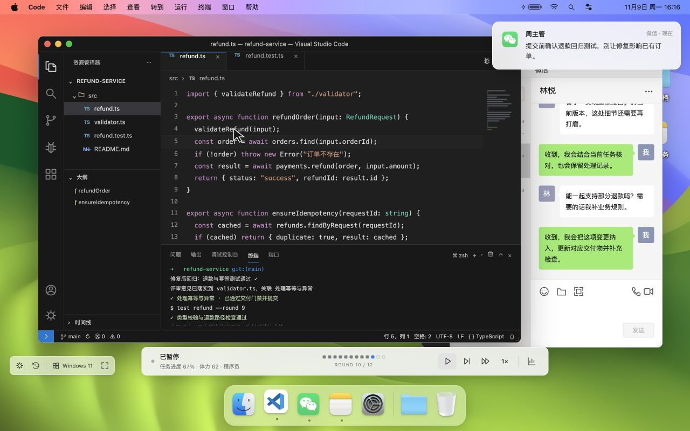
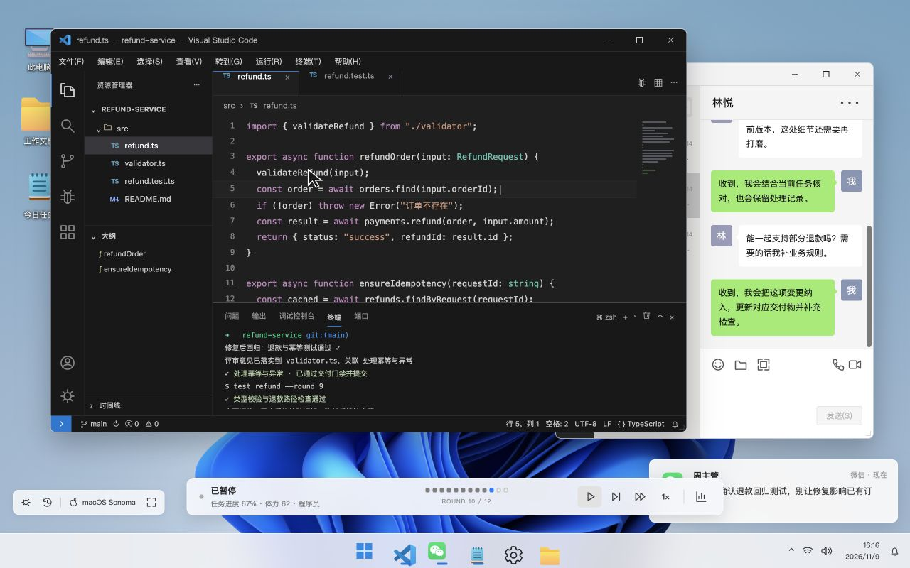

# GameX · 打工人桌面模拟器：2026

**设定你的工作方式，旁观另一个自己的一天。**

原生 JavaScript 单机网页游戏：选择职业与桌面外观，配置工作策略，观看虚拟员工自动处理任务和微信。在第 10 轮决定是否加班，完成 12 轮后复盘绩效，比较不同策略。

## 界面预览

macOS 桌面中的 VS Code 与微信：



Windows 桌面中的 VS Code 与微信：



## 本地运行

使用 Node.js 20.19 及以上版本。项目没有服务器端逻辑或运行时网络依赖。

```sh
npm ci --registry=https://registry.npmjs.org
npm run dev
```

打开终端输出的本地地址，通常为 `http://127.0.0.1:5173/`。若端口已占用，使用 Vite 实际输出的地址。

```sh
npm test
npm run build
npm run preview
```

`npm test` 使用 Node 内置测试运行器；`npm run build` 输出静态文件到 `dist/`，可用任意静态 HTTP 服务部署。首次安装可能需要设置可访问的 npm 镜像，锁文件固定实际依赖。

## 怎么玩

1. 选择程序员、财务、产品经理或设计师，查看任务书、前置依赖与已知环境。
2. 选择预设或调整四组策略。优先级最多启用 4 条，支持拖拽和箭头排序；提示说明每项收益和成本。
3. 选择 macOS/Windows 外观和播放节奏，开始自动工作。软件窗口只供观察，可拖动、缩放、最小化及恢复。
4. 使用播放栏暂停、倍速、跳到下一关键节点，或直接跳到加班决策。播放控制不会修改逻辑结果。
5. 第 10 轮后静候玩家选择。正常收尾也会完成最后两轮；加班增加产能，同时增加体力和过劳成本。
6. 查看分项绩效、短板与关键事件，再用相同种子调整策略，或在历史中勾选多局比较。

标准、快速、沉浸播放分别约 12 分钟、90 秒、45 分钟，均不含主动暂停和等待选择的时间。播放时长不是工作资源。

## 已实现能力

- 四职业专属交付物与风险：代码/技术债、关联表/合规、需求修订/范围、图层提案/创意疲劳。
- 微信消息、自动回复、反馈、变更、返工和软件画面来自同一条确定性动作流。
- 两套桌面外壳，包含不同的窗口装饰、Dock/任务栏、开始菜单、通知与系统布局。
- 图标与壁纸采用真实应用/系统素材，软件名称及主要区域按 VS Code、Excel、Word、Photoshop、微信对齐；[素材来源与版本](assets/SOURCES.md)随项目保留。
- 第 10 轮完整检查点、标签隐藏自动暂停、刷新后继续、六维评分、最近 50 局历史摘要与策略保存。
- 本局关系与响应期待不会跨局继承。多职业独立协作保留在 [TODO](TODO.md)，不在本版实现。

浏览器存储受限时仍可继续当前内存会话，界面会提示无法保证刷新恢复。完整回放保存在当前会话；历史只保留输入、绩效和关键事件摘要。

## 代码与验证入口

| 目录 | 职责 |
| --- | --- |
| `data/` | 职业、参数、任务、环境和 48 个候选事件 |
| `sim/` | 纯函数引擎、职业状态机、种子化随机数、规则、动作与评分 |
| `playback/` | 动作投影、观看游标、节奏和暂停/跳转 |
| `desktop/`、`apps/`、`ui/` | 系统外壳、窗口、办公软件与流程页面 |
| `meta/` | 存储兼容、当前会话、历史及比较 |
| `tests/` | 确定性、因果、恢复、评分、边界与 640 组策略样本 |

需求和实际验证以[需求 README](.agentdocs/workflow/REQ-20261109143131-单职业桌面模拟器/README.md)及其阶段记录为准。自动化模拟长时播放与真实隔夜挂机分别记录，不能互相替代。
